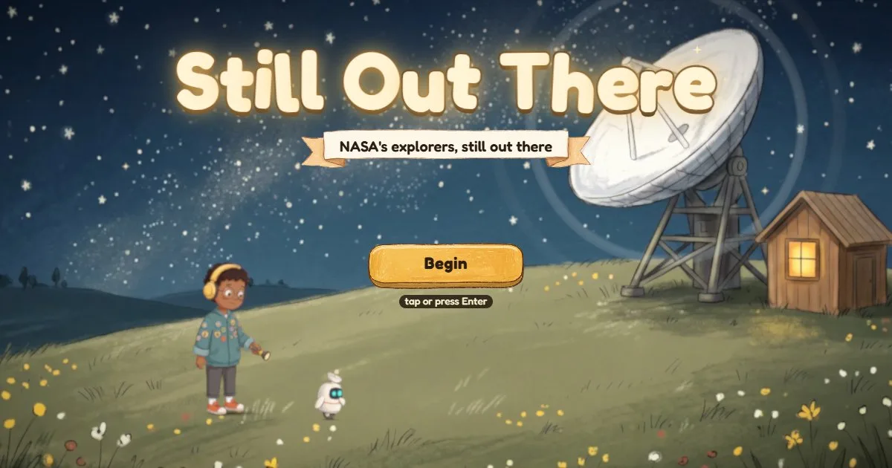

# Still Out There

**An animated crayon storybook about NASA's explorers that are still out there: on the Moon, on Mars and in deep space.**



**Live demo:** (link coming soon)

---

## About

This project answers a NASA hackathon challenge: tell the story of the hardware NASA has left on the Moon, on Mars and in deep space, for school-age space enthusiasts.

*Still Out There* is a living picture book. Readers turn pages of hand-drawn, gently animated scenes and tap things to make the story happen: landing Surveyor 3, firing a laser at the Moon, steering a rover under a dust devil, decoding the Pioneer plaque. Each explorer tells its own story, in its own words, with real facts and dates. Nothing can be failed, so young readers can explore freely, while older readers can open the Mission Log for more detail.

## The story

Kit, a new Signal Keeper, and their little robot Echo pick up a faint message from **Voyager 1**, the farthest machine people have ever built. Voyager asks them to visit the explorers that went first. The radio signal works like a door into each explorer's memory, so Kit and Echo appear in every scene as glowing visitors in little space helmets. At the end, the reader writes a message back to Voyager and watches it travel the 24 hours to reach it.

44 spreads in 7 parts:

| Part | Explorers |
| --- | --- |
| **Prologue: The Faint Signal** | Voyager 1 |
| **Chapter 1: The Moon**, "The Ones Who Proved It Was Possible" | Surveyor 3, the Apollo 11 lunar module *Eagle*, the laser reflector, the Apollo 12 science station, the Apollo 15 Lunar Roving Vehicle |
| **Chapter 2: Mars, The First Visitors** | Viking 1, Mars Pathfinder and Sojourner, Phoenix |
| **Chapter 3: Mars, The Long Drivers** | Spirit and Opportunity, InSight, Ingenuity and Perseverance |
| **Chapter 4: Small Worlds** | NEAR Shoemaker (on Eros), Dawn (at Vesta and Ceres) |
| **Chapter 5: Beyond**, "Eyes on the Stars" | Kepler, Pioneer 10 and Pioneer 11 |
| **Finale: One Light-Day** | Voyager 1, and a message from the reader |

## Features

- **Animated crayon scenes.** Every page is a layered scene with soft parallax, a hand-drawn "line boil", painted shadows and paper grain. NASA hardware keeps its real shape and never gets a face; it speaks through speech panels and a gentle glow.
- **16 tap moments.** Short, playful interactions from the script, such as tuning the dish, *Engine off!*, the laser bounce, releasing the airbags, flying Ingenuity, landing NEAR gently, spotting a planet's dip in starlight and decoding the Pioneer plaque.
- **Animated scenes made in code.** Viking's first picture building up stripe by stripe, Mars cut open to show crust, mantle and core, planets popping in around the stars, and a glowing marker in the sky for every explorer.
- **Mission Log facts.** Extra facts behind a tap, for older readers.
- **Three reading layers for all ages.** A big Spark line for young readers, a short Story for most readers, and the Mission Log for the curious.
- **Saving.** The book remembers your place and settings on your device. *Continue* picks up where you left off; *Start over* asks first.
- **Read-aloud.** A speaker button reads each page out loud (where the browser supports speech).
- **Settings.** Sound, music volume, calm motion, text size (three steps) and read-aloud.
- **Accessibility.**
  - Lighthouse accessibility **100**; axe (WCAG 2.1 A and AA) **0 issues** on the cover, Settings, Credits, the chapter menu and 10 representative pages.
  - Everything works with a keyboard; visible focus rings; Escape closes cards.
  - Every scene has a text description, and each page's words are announced to screen readers.
  - Reduced motion follows the device setting, or can be switched on in Settings.
  - Touch targets of at least 44 px, and WCAG AA contrast on all text.

## Accuracy

Every fact comes from the verified storyline behind [`docs/script.md`](docs/script.md), which is based on NASA and NSSDCA mission pages. All the sources are listed, by chapter, on the Credits screen (see [`src/data/sources.js`](src/data/sources.js)). Pages in the first person are told from the explorer's point of view; the facts in them are real. Voyager's lines about reaching one light-day from Earth change on November 18, 2026, the day it happens.

## Tech stack

| Tool | What it does here |
| --- | --- |
| [Vite](https://vitejs.dev) | Development server and production build |
| [React](https://react.dev) | The pages, speech bubbles, cards and controls |
| [React Three Fiber](https://r3f.docs.pmnd.rs) (three.js, drei, postprocessing) | The animated, layered scenes, depth of field and vignette |
| [Zustand](https://zustand.docs.pmnd.rs) | Reader progress and settings, saved in the browser |
| [Vitest](https://vitest.dev) | Unit tests (the date-aware Voyager text) |
| [Playwright](https://playwright.dev) with [axe-core](https://github.com/dequelabs/axe-core-npm) | Review screenshots, accessibility checks and end-to-end checks |
| [sharp](https://sharp.pixelplumbing.com) | Preparing the art (WebP, trimming, cleaning sprite edges) |

## Getting started

**Prerequisites:** [Node.js](https://nodejs.org) 20 or newer and [pnpm](https://pnpm.io) 9 or newer.

```bash
pnpm install        # install everything
pnpm dev            # start the development server at http://localhost:5173
pnpm build          # build for production into dist/
pnpm preview        # serve the production build at http://localhost:4173
pnpm test           # run the unit tests (Vitest)
```

### Playwright checks

Install the browser once:

```bash
pnpm exec playwright install chromium
```

Then, with the development server running (`pnpm dev`):

```bash
node scripts/check-bubbles.mjs    # speech bubbles fit and never cover the main explorer (every page, three screen sizes)
node scripts/check-taps.mjs       # plays all 16 tap moments with the keyboard
node scripts/check-save.mjs       # saving, Continue, Start over, and blocked storage
node scripts/check-a11y.mjs       # axe accessibility check on 14 screens
```

The checks use the computer's graphics card (the 3D scenes are too slow in a software-rendered browser); they were written and run on Windows.

## Project structure

```
docs/
  script.md            the storybook script: the source for all story text and facts
  images/              pictures used in this README
public/
  story.json           all 44 spreads, built from the script (don't edit by hand)
  art/                 web-ready art (made from /sprites)
  fonts/  sfx/  emotes/
sprites/               the original art, kept untouched
scripts/
  build-story.mjs      builds public/story.json from the spreads
  prepare-art.mjs      turns /sprites into public/art and src/data/art.js
  qa-shots.mjs         review screenshots and contact sheets
  check-*.mjs          the Playwright checks
src/
  App.jsx              page flow: cover, pages, choices, controls
  Scene.jsx            the animated 3D scene for each page
  Bubbles.jsx          speech bubbles and their layout
  Interacts.jsx        the tap-moment bar and Mission Log notes
  moments/             the 16 tap moments
  SceneAnims.jsx       the animated scenes made in code
  store.js             saved progress and settings (Zustand)
  lightDay.js          Voyager's date-aware words (+ lightDay.test.js)
  ui/                  page controls, Settings, Credits, read-aloud
  data/                art index and Credits sources
qa/screenshots/        numbered review folders with contact sheets
```

## Editing content

**Story text and scenes.** The spreads live in [`scripts/build-story.mjs`](scripts/build-story.mjs): text copied word for word from `docs/script.md`, plus the background, sprites, tap moments and animations of each page. After editing it, rebuild the story:

```bash
node scripts/build-story.mjs
```

The layer and bubble options are described in the `_help` block at the top of `public/story.json`.

**Art.** Put new or changed images in `/sprites` (in the matching folder), then run:

```bash
node scripts/prepare-art.mjs
```

It converts everything to WebP in `public/art/`, trims and cleans sprite edges, crops paper borders from backgrounds, and writes the art index `src/data/art.js`. In `story.json` and the build script, images are referred to by name, for example `"kit_helmet_idle"`.

**Review screenshots.** Take phone, tablet and desktop shots of any pages, plus a labeled contact sheet per page:

```bash
node scripts/qa-shots.mjs 10-my-change title moon-1 mars2-7
```

It starts the development server if needed and writes `qa/screenshots/10-my-change/` (contact sheets and a `NOTES.md` are kept in git; the per-device shots stay on your computer). Page ids are the state ids in `story.json`; `title`, `settings`, `credits` and `title-continue` show the cover screens, and `moon-1@text3` or `mars1-4@reduce` show a page at a larger text size or with reduced motion.

## Credits

- Made by **Team Fibonacci**, under the guidance of **FreeFall-labs**.
- Facts from NASA and NSSDCA mission pages, listed by chapter on the Credits screen and in `src/data/sources.js`.
- Interface sounds and emotes by [Kenney](https://kenney.nl) (CC0).
- The [Fredoka](https://github.com/hafontia/Fredoka-One) font, under the SIL Open Font License (`public/fonts/OFL-Fredoka.txt`).
- The layer shader is based on work by Gianmarco Simone ([@ggsimm](https://twitter.com/ggsimm)).
- Ambient music: source to be confirmed.

## Disclaimer

This project is not affiliated with or endorsed by NASA.

## License

License: to be decided.
